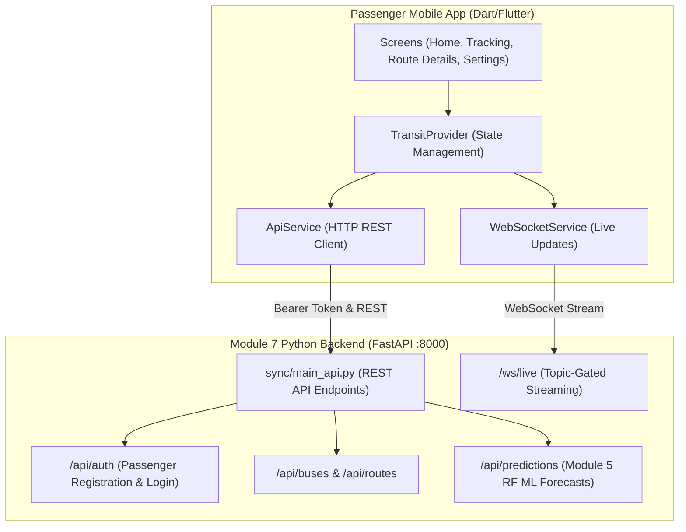

# Smart Public Transport — Passenger Mobile Application (BMTC-Inspired)

A responsive, lightweight Flutter passenger mobile application designed for public bus commuters. Integrates with the Module 7 Python FastAPI backend, offering live bus occupancy monitoring, OpenStreetMap spatial tracking, multi-stop crowding forecasts (Module 5 Random Forest), and less-crowded alternative bus suggestions.

---

## Architecture & Integration Overview



---

## 1. Features Implemented

1. **Authentication & Profile:**
   - Registration and Login enforcing role `passenger`.
   - Token lifecycle handling and secure logout.
2. **Home Screen:**
   - Real-time search by Bus ID (e.g., `KA-BUS-004`) or Corridor (e.g., `R101`).
   - Live Passenger Crowding Warning Banners.
   - Corridor Topography quick selector.
   - Dynamic occupancy bars with available capacity counter.
3. **Live Bus Spatial Tracking:**
   - Interactive OpenStreetMap view centered on live vehicle coordinates.
   - Dynamic status badges: `NORMAL` (Green), `WARNING` (Orange), `CRITICAL` (Red).
4. **Multi-Stop Occupancy Forecasting (AI Forecasts):**
   - Direct integration with Module 5 Random Forest predictions API (`/api/predictions/{bus_id}/{stop_id}`).
   - Lookahead for 1, 2, and 3 stops ahead with clear distinction between actual counts and probabilistic forecasts.
5. **Less-Crowded Alternative Bus Recommendations:**
   - Real-time algorithmic filter identifying less congested buses traveling the same corridor.
6. **Route Details & Timetables:**
   - Ordered stop sequences with origin/destination indicators.
   - Active bus roster operating on the chosen corridor.

---

## 2. Compilation & Execution Guide

### Prerequisites
- Install the **Flutter SDK** (Version `>= 3.0.0`) from [flutter.dev](https://flutter.dev/docs/get-started/install).
- Add Flutter to your environment PATH.

### Running the App
1. Start the Module 7 Python backend server:
   ```powershell
   python -m uvicorn sync.main_api:app --host 0.0.0.0 --port 8000
   ```
2. Navigate to the mobile app directory:
   ```powershell
   cd passenger_mobile_app
   ```
3. Fetch dependencies:
   ```powershell
   flutter pub get
   ```
4. Run on your desired target (Chrome, Android emulator, or physical device):
   ```powershell
   flutter run
   ```

*Note: For Android emulators, the app automatically defaults to `http://10.0.2.2:8000` to access localhost.*

